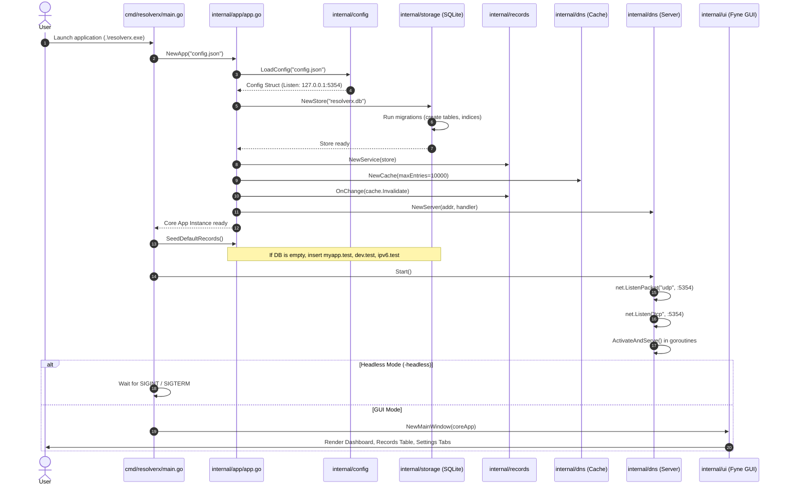
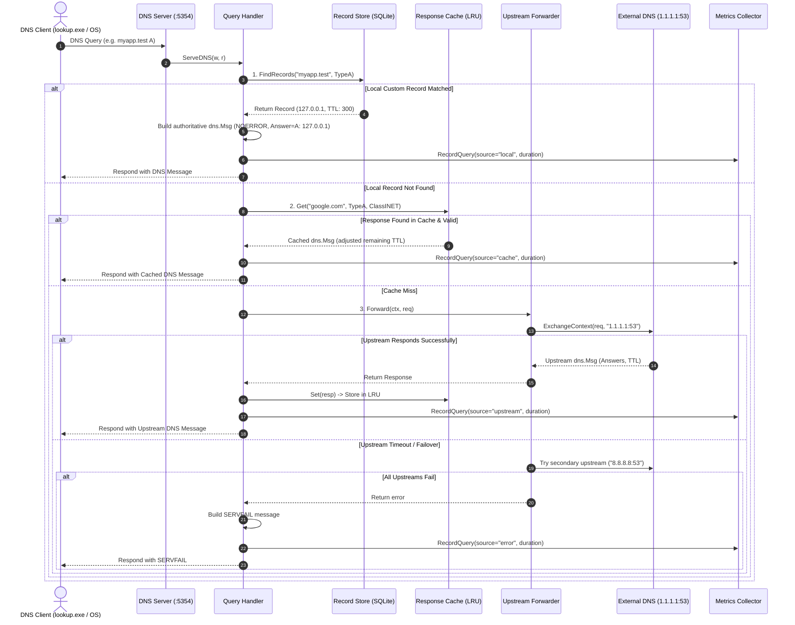
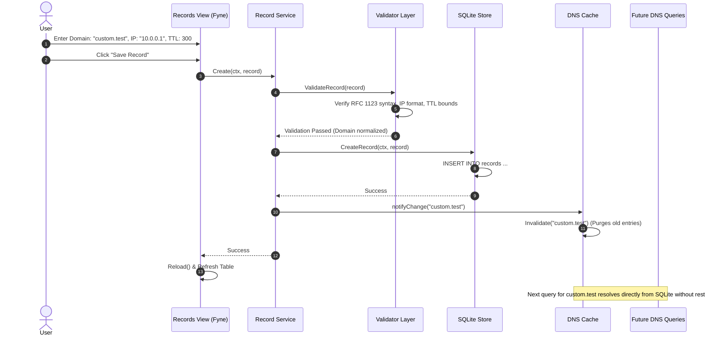
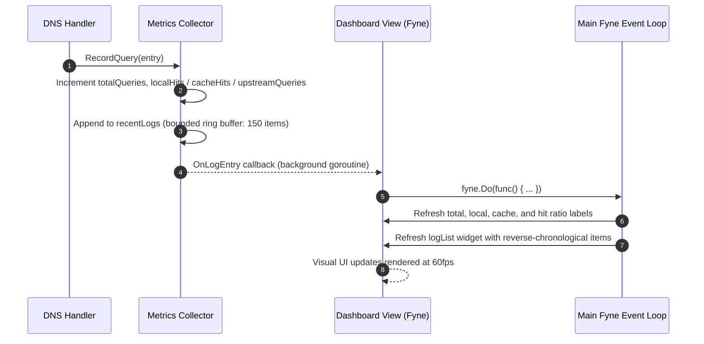

# ResolverX — Execution & Data Flow Architecture

This document maps out the end-to-end data flows, lifecycle sequences, and communication patterns across ResolverX.

---

## 1. Application Initialization & Startup Flow

---

## 2. DNS Query Resolution Flow

When a DNS query arrives over UDP or TCP on `127.0.0.1:5354`:

---

## 3. Record Mutation & Invalidation Flow

How changes made via the GUI instantly update the running DNS engine:

---

## 4. Real-Time Dashboard & Query Logging Flow

